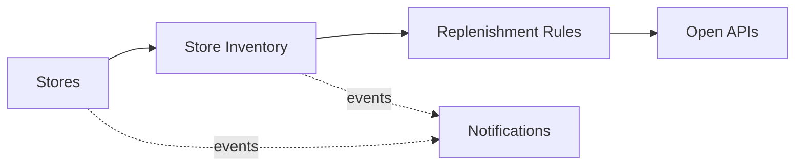

# Domain Model and Bounded Contexts

Ubiquitous language and context design (view VP-4). Domain-standard concepts are mapped
normatively in `../domain/domain-standards.md` (CR-5).

## Ubiquitous language (selected terms)

| Term | Meaning |
|---|---|
| **Store** | A physical or dark store in one region and format |
| **Store inventory** | The guarded available-units account of a SKU at a store |
| **Store reservation** | One draw against store stock (POS, click-and-collect, delivery) |
| **Replenishment rule** | A decision rule binding a category to safety-stock and shrinkage envelopes |
| **Promotion** | A catalogue promotion (discount, bundle, loyalty) |
| **Shrinkage risk score** | A transparent 0-100 store risk score |

## Bounded contexts and invariants

### Stores — `store-service`
Store registry: formats and regions. Lifecycle: `ACTIVE` → transitions
suspend, reactivate. Customer personal data is minimized and stays in adopter CRM systems; this core works with store, stock and promotion data. Card data never enters the platform (certified payment boundary).

### Store Inventory — `store-inventory-service`
Guarded per-store SKU stock and the channel reservations against it. **Invariant (ADR-0004): a store's sellable stock is never oversold across POS, click-and-collect and delivery — a reservation that exceeds available units is rejected (422) and records nothing.** Consumption records are
append-only evidence; a rejected operation records nothing.

### Replenishment Rules — `replenishment-rules-service`
Decision rules binding categories to safety-stock and shrinkage envelopes. Only ACTIVE rules decide; evaluation order is by priority; every decision
is ALLOWED / DEGRADED / DENIED with the matched rule and a human-readable reason.

### Promotions — `promotion-catalog-service`
Promotion catalogue: discounts, bundles and loyalty offers.

### Notifications — `notification-service`
Delivery trail for audit; recipients are never logged.

## Context map

